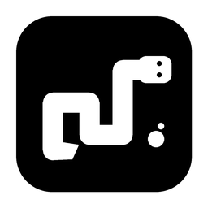
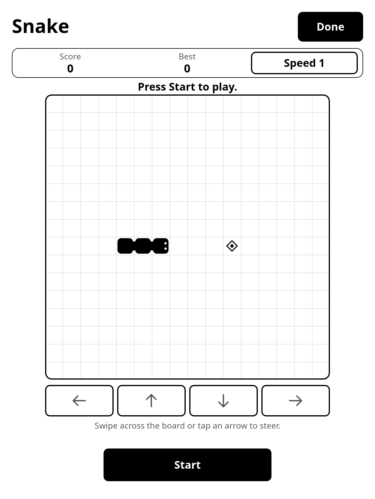
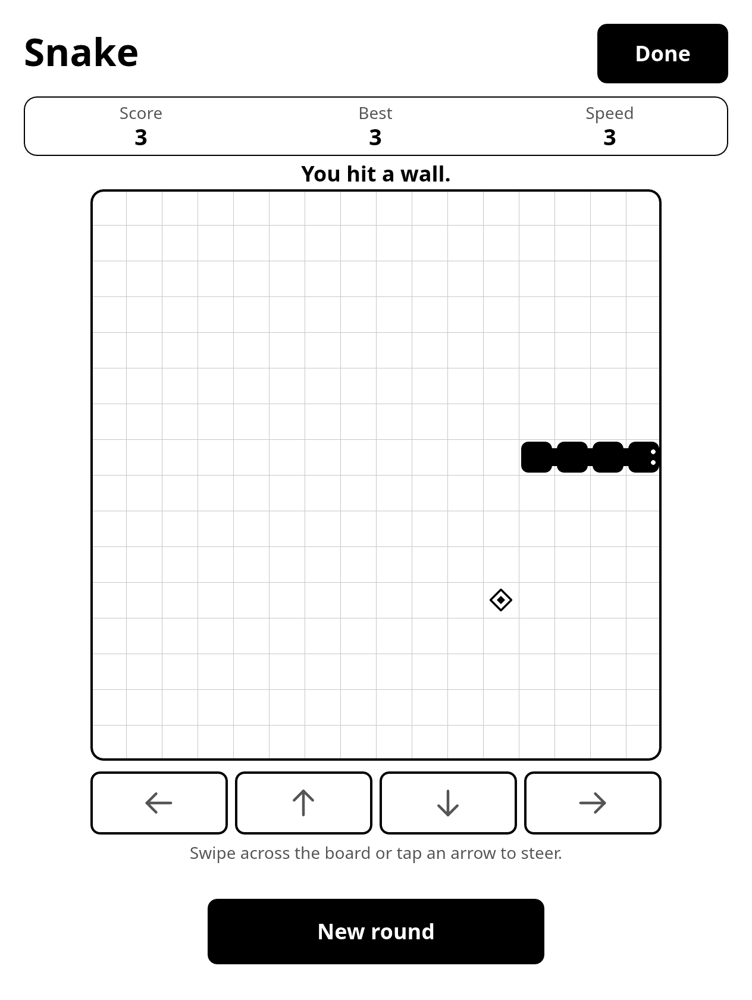

<div align="center">



# Snake

**Keep moving and beat your best score**

[](https://github.com/PrimitiveOS/kindle-primitive-snake/actions/workflows/ci.yml)
[](https://github.com/PrimitiveOS/kindle-primitive-snake/releases)
[](https://github.com/PrimitiveOS/kindle-primitive-snake/tags)
[](LICENSE)
[](https://github.com/PrimitiveOS/kindle-primitive-snake/stargazers)
[](https://primitiveos.github.io/kindle-primitive-catalog/v1/index.json)

[**Download**](https://github.com/PrimitiveOS/kindle-primitive-snake/releases/latest) · [**Install guide**](INSTALL.md) · [**Changelog**](CHANGELOG.md)

</div>

---

Choose a speed from 1 to 9 and steer a continuously moving snake. Each bite adds a segment and awards points equal to your chosen speed. Fill the board for a 100-point bonus. A wall or body collision ends the round.

Swipe or tap the arrow buttons to steer. Pause at any time and beat your saved best score.

## Quick start

After setting up PrimitiveOS, open **Store** from Primitive Launcher. Choose **Snake** under **Apps**,
tap **Get**, and open it from the Launcher grid. The [install guide](INSTALL.md) also covers the standalone USB package.

## Screenshots

<table>
<tr>
<td align="center"><br><sub>Ready to play</sub></td>
<td align="center"><br><sub>Speed selection</sub></td>
</tr>
<tr>
<td align="center"><br><sub>Dark mode</sub></td>
<td align="center"><br><sub>End of a round</sub></td>
</tr>
</table>

Desktop simulation captures at 1264 × 1680 pixels.

## Develop locally

Keep the Tools and Launcher checkouts next to this repository.

```sh
cargo test --offline --locked --workspace
cargo run --offline --locked -p snake-desktop
```

The desktop run exercises the game timer, steering, pause, and game over. It writes previews to `build/previews/`.

## Highlights

- Choose a speed from 1 to 9 and steer a continuously moving snake.
- Each bite adds a segment and awards points equal to your chosen speed.
- Fill the board for a 100-point bonus.

## Status

| Device | Status |
|---|---|
| Kindle Oasis 3 (1264 × 1680, firmware 5.18.2) | Tested on hardware |

**Current version: 0.1.1.** Changes are in [CHANGELOG.md](CHANGELOG.md).

## Downloads

The badge at the top shows the number of Store downloads. It counts GitHub downloads of this app's release packages, across all versions and architectures, and is refreshed daily from the [Store catalog](https://primitiveos.github.io/kindle-primitive-catalog/v1/index.json).

## Documentation

[Install guide](INSTALL.md) · [Changelog](CHANGELOG.md)

## Licence

Copyright (C) 2026 Doan Nguyen.

Code is licensed under [PolyForm Noncommercial 1.0.0](LICENSE). The documentation and original art are
licensed under [CC BY-NC-SA 4.0](LICENSE-DOCS).
