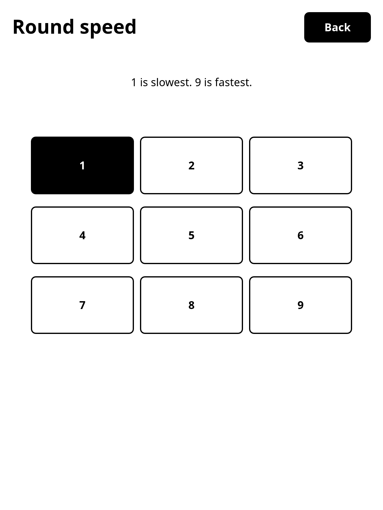
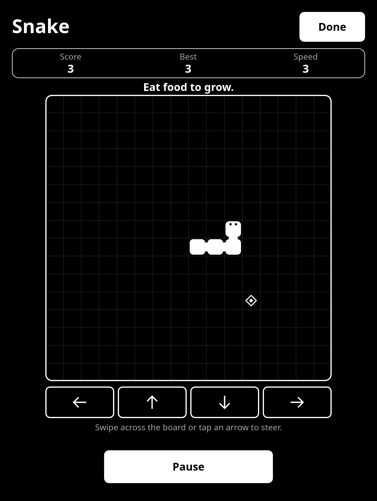

# Snake

**Catch food, grow your tail, and beat your best score.**

Snake is a native PrimitiveOS game for Kindle inspired by the early mobile arcade game. The snake moves continuously. Choose a speed before the round and catch food to grow.

## How to play

- Choose **Speed** from 1 to 9, then tap **Start**. Swipe on the board or tap an arrow to steer.
- Each bite adds one segment and scores points equal to your chosen speed. Filling the board adds 100 points. A wall or tail collision ends the round.
- Tap **Pause** to stop movement or **New round** to play again after a collision. Your best score saves between launches.

**Done** returns to Launcher.

## Screenshots

<table>
<tr>
<td align="center"><br><sub>Ready to play</sub></td>
<td align="center"><br><sub>Speed selection</sub></td>
</tr>
<tr>
<td align="center"><br><sub>Dark mode</sub></td>
<td align="center"><br><sub>End of a round</sub></td>
</tr>
</table>

Desktop simulation captures at 1264 × 1680 pixels.

## Install

After setting up PrimitiveOS, open **Store** from Launcher. Find **Snake** under **Apps** and choose **Get**.
See the [installation guide](INSTALL.md) for the local build workflow.

## Develop locally

Keep the Tools and Launcher checkouts next to this repository.

```sh
cargo test --offline --locked --workspace
cargo run --offline --locked -p snake-desktop
```

The desktop run exercises the game timer, steering, pause, and game over. It writes previews to `build/previews/`.

## Licence

Copyright (C) 2026 Doan Nguyen.

Code is licensed under [PolyForm Noncommercial 1.0.0](LICENSE). The documentation and original art are
licensed under [CC BY-NC-SA 4.0](LICENSE-DOCS).
